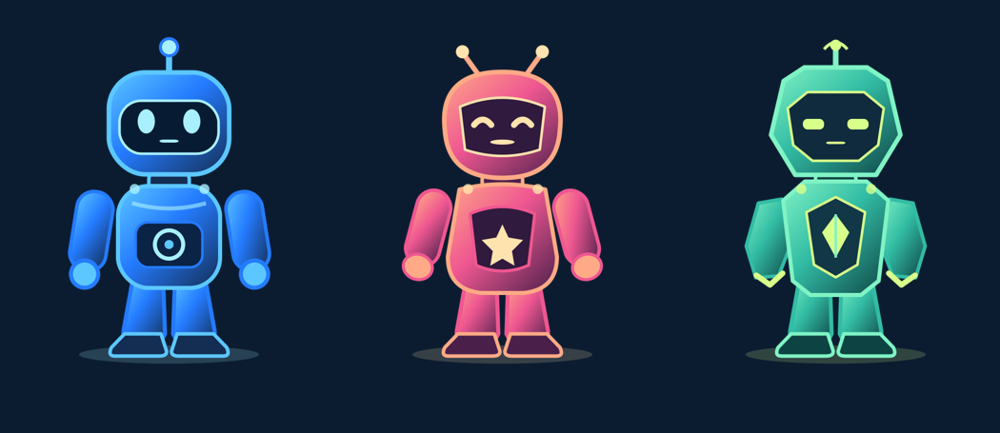

# 🤖 VoxHRI
### Voice-Based Human-Robot Interaction for Educational Robotics


VoxHRI is a Python-based educational application designed to explore voice-driven human-robot interaction through animated robotic avatars and large language models (LLMs).

The system integrates speech recognition, cloud-based language generation, text-to-speech synthesis, conversational context, and automatic experimental data collection into an interactive desktop application.

Its primary goal is to support educational activities involving artificial intelligence, natural language interaction, English communication, and introductory robotics concepts.

## 🖥️ Application Preview



The application provides three animated robotic avatars: Atlas, Nova, and Orbit. The avatars visually respond to speech playback, creating an accessible conversational interface.

VoxHRI is a screen-based robotic avatar application, not a physical robot.

## ✨ Main Features

- 🎙️ Voice-based interaction using speech recognition.
- 🧠 Integration with NVIDIA Nemotron 3 Super 120B through OpenRouter.
- 💬 Context-aware conversations with retained dialogue history.
- 🔊 Text-to-speech synthesis using pyttsx3.
- 🤖 Three animated robotic avatars with selectable visual identities.
- ⌨️ Keyboard-based interaction as an alternative to microphone input.
- 📊 Automatic experimental data collection and statistical analysis.
- 📈 Automatic generation of ten performance and reliability figures.
- 📝 Human evaluation worksheet for assessing response quality.
- 🌐 English-language interface, interaction protocol, documentation, and output files.

## 🏗️ System Architecture

The application is organized into independent Python modules responsible for interaction, communication, audio processing, data management, and statistical analysis.

| Component | Technology | Function |
|---|---|---|
| Graphical interface | Pygame | Interactive GUI and animated avatars |
| Programming language | Python | Application architecture and processing |
| Speech recognition | SpeechRecognition | Microphone input and transcription |
| Speech recognition service | Google Speech Recognition | Online speech-to-text |
| Language model | NVIDIA Nemotron 3 Super 120B | Natural language understanding and generation |
| LLM communication | OpenRouter API | Cloud inference and streaming responses |
| HTTP communication | Requests | API requests and metadata retrieval |
| Speech synthesis | pyttsx3 | Spoken responses |
| Data storage | CSV / JSON | Experimental records and session metadata |
| Data visualization | Matplotlib | Statistical figures and performance analysis |

### Language Model Integration

VoxHRI uses the following model identifier:

`nvidia/nemotron-3-super-120b-a12b`

Communication is performed through the OpenRouter API using streaming responses.

The application records relevant information returned by the API, including:

- Requested and reported model identifiers.
- Inference provider, when available.
- Input and output token counts.
- Generation latency.
- Time to First Token (TTFT).
- Reported API cost.
- Generation identifiers.

The actual inference provider may vary according to OpenRouter routing and availability.

## 🧪 Experimental Protocol

The application includes a fixed English-language protocol containing 30 sequential questions divided into six categories.

| Category | Questions | Objective |
|---|---:|---|
| General Knowledge | 5 | Basic knowledge and factual responses |
| Robotics Education | 5 | Introductory robotics and scientific concepts |
| Reasoning and Instructions | 5 | Basic reasoning and procedural instructions |
| Conversational Memory | 5 | Retention of information across dialogue turns |
| Dialogue Continuity | 5 | Contextual consistency across conversations |
| Natural Conversation | 5 | Everyday conversational interaction |
| Total | 30 | Sequential conversational session |

Questions are displayed individually. The participant reads the displayed question aloud, and the application captures and transcribes the speech before sending it to the language model.

Typed input is also supported.

The application records the recognized input and generated response, allowing subsequent analysis of transcription discrepancies and conversational behavior.

Each session represents one sequential dialogue containing up to 30 successful interactions, rather than 30 independent experimental replicates.

## 📊 Automatic Data Collection

Experimental information is saved incrementally during execution.

The application records:

- Original reference prompts.
- Recognized speech transcripts.
- User input and generated responses.
- Input and output word counts.
- Conversational history size.
- Speech recognition duration.
- LLM response duration.
- Time to First Token (TTFT).
- Text-to-speech and playback duration.
- Total interaction duration.
- Input and output tokens.
- Reported API cost.
- Model and provider metadata.
- API errors and speech recognition failures.

Speech recognition errors are stored separately from language model requests.

### Automatic Figures

After a real experimental session is finalized, VoxHRI automatically generates ten figures:

1. Measured conversational stage durations.
2. Cloud LLM latency across successive requests.
3. First visible token and complete response.
4. Latency percentiles (P50, P90, and P95).
5. OpenRouter token usage per conversational turn.
6. Generated tokens versus cloud response time.
7. Retained dialogue turns versus prompt tokens.
8. Spoken response length versus playback duration.
9. Accumulated reported API cost.
10. Reliability: observed successful requests and failures.

The statistical processing also exports descriptive statistics, a figure index, and a JSON summary.

Missing measurements are not artificially estimated.

## 📁 Project Structure

```text
VoxHRI/
│
└── VoxHRI/
    ├── main.py
    ├── audio.py
    ├── openrouter_client.py
    ├── storage.py
    ├── study_protocol.py
    ├── human_evaluation.py
    ├── charts.py
    │
    ├── config.example.py
    ├── config.py
    ├── requirements.txt
    ├── requirements-graphs.txt
    ├── start_windows.bat
    │
    ├── assets/
    │   ├── atlas_open.png
    │   ├── atlas_closed.png
    │   ├── nova_open.png
    │   ├── nova_closed.png
    │   ├── orbit_open.png
    │   └── orbit_closed.png
    │
    ├── protocol/
    │   ├── questions.csv
    │   └── QUESTIONS_EN.md
    │
    ├── tests/
    │   └── test_offline.py
    │
    └── results/
        ├── README.txt
        ├── sessions/
        └── demos/
```

Each experimental session is stored in an independent directory:

```text
results/
└── sessions/
    └── SESSION_NAME/
        ├── interactions.csv
        ├── stt_errors.csv
        ├── questions.csv
        ├── session_config.json
        ├── session_summary.json
        ├── human_evaluation.csv
        │
        └── figures/
            ├── 01_stage_durations.png
            ├── 02_llm_latency_by_turn.png
            ├── 03_ttft_vs_complete.png
            ├── 04_latency_percentiles.png
            ├── 05_tokens_by_turn.png
            ├── 06_output_tokens_vs_llm_time.png
            ├── 07_context_vs_input_tokens.png
            ├── 08_words_vs_tts_time.png
            ├── 09_known_cumulative_cost.png
            ├── 10_reliability_event_counts.png
            ├── descriptive_statistics.csv
            ├── figure_index.csv
            └── summary.json
```

## ⚙️ Installation

### Requirements

- Windows operating system (the provided startup script targets Windows).
- Python 3.
- Internet connection.
- OpenRouter API key.
- Microphone and audio output device.

### 1. Clone the Repository

```bash
git clone https://github.com/vitor-souza-ime/VoxHRI.git
cd VoxHRI/VoxHRI
```

### 2. Create a Virtual Environment

```bash
py -m venv .venv
```

Activate it:

```powershell
.\.venv\Scripts\Activate.ps1
```

### 3. Install Dependencies

```bash
py -m pip install --upgrade pip
py -m pip install -r requirements.txt
```

### 4. Configure OpenRouter

Create the local configuration file using the provided template:

```powershell
copy config.example.py config.py
```

Configure your OpenRouter API key in `config.py`, or leave `API_KEY` empty and use the `OPENROUTER_API_KEY` environment variable.

Example using PowerShell:

```powershell
$env:OPENROUTER_API_KEY = "YOUR_OPENROUTER_API_KEY"
```

Never publish your actual API key or commit a configuration file containing credentials.

### 5. Run VoxHRI

```bash
py main.py
```

Alternatively, on Windows:

```bash
start_windows.bat
```

## 🎮 Application Controls

| Key | Action |
|---|---|
| S | Start the experimental session |
| F | Finish the current session and generate outputs |
| T | Enter a question using the keyboard |
| V | Enable or disable microphone input |
| 1 / 2 / 3 | Select an avatar |
| Space | Switch to the next avatar |
| R | Display the current session report |
| Enter | Submit typed input |
| Esc | Exit safely |

The application automatically finalizes the session after 30 successful answers.

Pressing F allows an early finish. Such sessions are saved and explicitly marked as incomplete.

## 📈 Generating Figures Manually

Figures are generated automatically when a real session is finalized.

If necessary, they can also be regenerated manually:

```bash
py charts.py --csv results/sessions/SESSION_NAME/interactions.csv --out results/sessions/SESSION_NAME/figures
```

The graph generation module uses Matplotlib and processes the recorded CSV data.

## 🧪 Offline Testing

VoxHRI includes an offline mode for checking the graphical interface without contacting OpenRouter.

Run:

```bash
py main.py --demo --no-mic --no-tts
```

The simulated session is stored separately under:

```text
results/demos/
```

Demo observations must never be mixed with real experimental data.

To run the automated tests:

```bash
py -m unittest discover -s tests -v
```

## 🎓 Educational Applications and Future Work

VoxHRI is designed as a software platform for exploring conversational artificial intelligence and human-robot interaction in educational contexts.

Potential applications include:

- Introducing students to large language models.
- Exploring voice-based human-computer interaction.
- Practicing English through conversational interaction.
- Discussing introductory robotics and artificial intelligence concepts.
- Investigating conversational memory and dialogue continuity.
- Supporting interactive educational activities.

Future work includes deploying VoxHRI in schools and conducting classroom-based evaluations.

These studies will investigate student engagement, conversational interaction, learning progression, and the potential use of recorded interactions to monitor educational development over time.

The classroom evaluation and longitudinal student-progress monitoring are planned extensions and are not yet validated features of the current implementation.

## 🔬 Research and Reproducibility

VoxHRI was developed to support experimental investigation of voice-driven interaction with cloud-based language models.

The project provides:

- A fixed conversational protocol.
- Incremental experimental logging.
- Session-specific data storage.
- Model and provider metadata.
- Automatic statistical analysis.
- Reproducible figure generation.
- Offline automated tests.

All measurements should be interpreted according to their operational definitions. Speech recognition duration includes listening and audio capture, while text-to-speech duration includes engine initialization and playback.

The generated human evaluation worksheet allows reviewers to assess relevance, factual accuracy, contextual consistency, English fluency, and unsupported claims.

## 📚 Technologies and Resources

- [Python](https://www.python.org/)
- [Pygame](https://www.pygame.org/)
- [OpenRouter](https://openrouter.ai/)
- [NVIDIA Nemotron](https://build.nvidia.com/)
- [SpeechRecognition](https://pypi.org/project/SpeechRecognition/)
- [pyttsx3](https://pypi.org/project/pyttsx3/)
- [Matplotlib](https://matplotlib.org/)
- [Requests](https://requests.readthedocs.io/)

## 🔗 Repository

Source code, experimental protocol, and supporting scripts:

https://github.com/vitor-souza-ime/VoxHRI

---

VoxHRI — Exploring Voice-Based Human-Robot Interaction for Educational Robotics.
